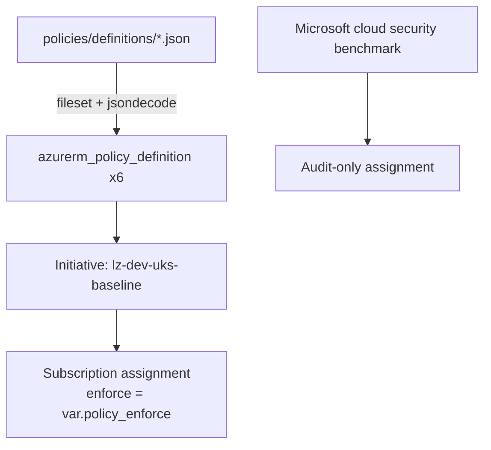
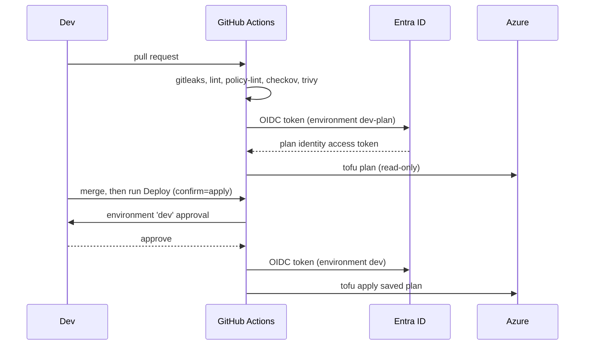

# Architecture

## Goals

- A secure-by-default foundation that one person can deploy, understand and tear down.
- Every control expressed as code and checked in CI before it reaches Azure.
- Near-zero idle cost. Expensive components are opt-in flags.

## Network

| VNet | Range | Subnets |
|---|---|---|
| Hub | 10.0.0.0/22 | AzureFirewallSubnet /26, AzureFirewallManagementSubnet /26, AzureBastionSubnet /26, snet-shared-services /26 |
| Spoke app | 10.1.0.0/22 | snet-web (443), snet-api (8443) |
| Spoke data | 10.2.0.0/22 | snet-db (5432), snet-private-endpoints (443) |

- Spokes peer with the hub in both directions. Spokes are not peered with each other, so traffic between spokes has to go through the hub firewall when it is enabled.
- When `enable_firewall = true`, each spoke subnet gets a route table that sends 0.0.0.0/0 to the firewall's private IP.
- Spoke subnets set `default_outbound_access_enabled = false`, so there is no implicit internet egress.
- Each subnet NSG allows only its declared port from 10.0.0.0/8 and ends with an explicit deny-all inbound rule.
- The Bastion subnet NSG carries the rules Microsoft requires for Bastion. The shared-services NSG denies all inbound.

## Logging and monitoring

- One Log Analytics workspace receives:
  - activity log (Administrative, Security, Policy, Alert);
  - Key Vault audit logs;
  - firewall logs and metrics;
  - VNet flow logs with traffic analytics.
- The daily ingestion cap is 1 GB to bound cost. Retention is configurable and defaults to 30 days.
- Flow logs use VNet flow logs. NSG flow logs are being retired (see ADR-0005).
- A consumption budget alerts at 80% of £20 actual spend and at 100% forecast.

## Identity and access

- **Humans:** whoever runs the bootstrap gets Key Vault Administrator on the vault through Terraform. Data-plane access is RBAC-only, with no access policies.
- **Pipeline:** two Entra applications with GitHub OIDC federated credentials and no client secrets (ADR-0006).
  - The plan identity has Reader on the subscription and Storage Blob Data Contributor on the state account. It is trusted only from the `dev-plan` environment.
  - The apply identity has Contributor, Resource Policy Contributor, Storage Blob Data Contributor on state, and Role Based Access Control Administrator. That last role is limited by an ABAC condition so it can only assign Key Vault Administrator. It is trusted only from the `dev` environment, which needs a reviewer.
- Terraform state uses Entra ID auth (`use_azuread_auth`). The state account has shared keys disabled, versioning on and 14-day soft delete.

## Governance

| Definition | Default effect |
|---|---|
| Allowed locations (uksouth, ukwest) | Deny |
| Require owner, environment and cost-centre tags on resource groups | Deny |
| Deny public IP on network interfaces | Deny |
| Deny RDP/SSH from the internet (standalone and inline NSG rules) | Deny |
| Storage secure transfer required | Deny |
| Key Vault purge protection | Audit |

`policy_enforce = false` switches the assignment to DoNotEnforce. That lets a new rule be observed in compliance results before it starts blocking anything.

## Deployment flow

